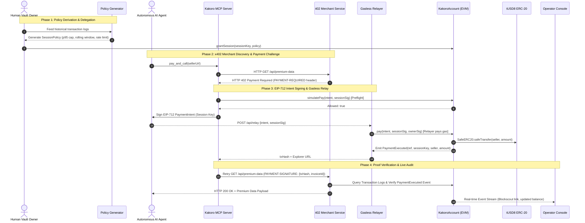

# KakoroPay (Aevum EVM Edition)

> **Autonomous AI Agent Payments with Least-Privilege Data-Derived Spend Policies on QDay Aevum Testnet (Chain ID: 44005).**  
> *Submission for the Aevum Builder Challenge #1.*

---

## 1. Executive Summary

Autonomous AI agents equipped with LLMs and web automation tools are increasingly executing economic transactions. However, granting an AI direct access to a private key or unfettered wallet balance invites catastrophe: prompt injection attacks, runaway looping calls, and compromised credentials can drain a treasury in seconds.

**KakoroPay solves this through smart-account policy enforcement and gasless session keys:**
- **Zero-Fund Session Keys:** AI agents hold scoped ECDSA session keys that possess **0 gas** and **0 token balance**.
- **Data-Derived Spend Policies:** Policies are automatically generated from historic usage logs using percentile-based outlier rejection ($p_{95} \times \text{margin}$) to calculate granular per-call caps, rolling window caps, rate limits, and approval thresholds.
- **Gasless Relayer Broadcaster:** Agents sign EIP-712 typed intents (`PaymentIntent`), broadcast via a relayer that sponsors gas fees, while the `KakoroAccount` contract verifies constraints and executes the tUSD8 transfer.
- **Instant Revocation & Circuit Breaker:** Human vault owners can revoke compromised session keys or pause the entire vault in a single transaction without redeploying.
- **Confirmation-of-Payee Protection:** Integrated `PayeeRegistry` prevents agents from sending funds to unvetted or spoofed payee addresses.

---

## 2. High-Level Architecture & Flow



---

## 3. Quickstart: 1-Command Demo

Run the end-to-end integration demo showing identity generation, policy derivation, 402 negotiation, EIP-712 signing, relayer broadcast, and on-chain verification:

```bash
# In the repository root:
python demo/run_demo.py
```

### Running Test Suites
```bash
# 1. Solidity Smart Contract Tests (Foundry with Invariant Fuzzing)
cd contracts
forge test -vv

# 2. Python Ecosystem Tests (SDK, Relayer, Seller, Payer, MCP, Policy, Console, E2E)
cd ..
pytest -v
```

---

## 4. Repository Structure & Components

```
KakoroPay-Aevum/
├── contracts/               # Solidity Smart Contracts (Foundry)
│   ├── src/
│   │   ├── KakoroAccount.sol# Policy-bound smart account vault (EIP-712, SafeERC20)
│   │   ├── PayeeRegistry.sol# Confirmation-of-Payee attestation registry
│   │   └── MockERC20.sol    # Testnet tUSD8 token mock
│   └── test/
│       ├── KakoroAccount.t.sol           # 19 Unit and Fuzz test cases
│       └── KakoroAccountInvariant.t.sol  # Invariant testing (12,800 fuzzed calls)
├── sdk/                     # kakoro-sdk: Python Client Library
│   ├── kakoro_sdk/
│   │   ├── client.py        # Autonomous agent payment client with 402 retry
│   │   ├── signer.py        # EIP-712 typed data hashing and ECDSA signing
│   │   ├── ssrf.py          # Anti-SSRF URL validator (blocks private & cloud IPs)
│   │   ├── verifier.py      # On-chain ReceiptVerifier for merchants
│   │   └── types.py         # Pydantic data models (PaymentIntent, PaymentProof)
│   └── tests/test_sdk.py
├── relayer/                 # Gasless Transaction Relayer Service
│   ├── src/relayer.py       # FastAPI relayer service with /api/simulate & /api/relay
│   └── tests/test_relayer.py
├── seller/                  # HTTP 402 Merchant Service
│   ├── src/seller.py        # FastAPI x402 server with replay prevention & verification
│   └── tests/test_seller.py
├── payer/                   # Isolated Signer Service
│   ├── src/payer.py         # Standalone service protecting session keys
│   └── tests/test_payer.py
├── mcp-server/              # Model Context Protocol (MCP) Server for LLMs
│   ├── src/kakoro_mcp/server.py # FastMCP server (discover_resources, check_budget, pay_and_call)
│   └── tests/test_mcp.py
├── policy-generator/        # Data-Derived Heuristic Policy Generator
│   ├── src/kakoro_policy/
│   │   ├── generator.py     # Percentile scoring, outlier filtering, rate estimator
│   │   └── schema.py        # SessionPolicySpec model
│   └── tests/test_policy.py
├── console/                 # Operator Management Console
│   ├── src/server.py        # FastAPI console server with WebSockets/SSE
│   ├── src/static/          # Vanilla JS / CSS dark-mode dashboard
│   └── tests/test_console.py
└── demo/                    # End-to-End Orchestrator & Integration
    ├── run_demo.py          # Comprehensive live demonstration
    └── tests/test_e2e_flow.py
```

---

## 5. Smart Contract Technical Specification

### 5.1 EIP-712 PaymentIntent
```solidity
struct PaymentIntent {
    address token;
    address payee;
    uint256 amount;
    bytes32 ref;       // Invoice identifier / Idempotency key
    uint256 deadline;  // Expiration timestamp
    uint256 nonce;     // Session key nonce
}
```

- **Domain Separator:** Name: `"KakoroAccount"`, Version: `"1"`, ChainId: `44005`, VerifyingContract: `address(this)`.
- **Session Policy:**
  ```solidity
  struct SessionPolicy {
      uint48 expiry;
      uint256 perCallCap;
      uint256 windowCap;
      uint32 windowSeconds;
      uint32 maxCallsPerWindow;
      uint256 approvalThreshold;
      bool requireVerifiedPayee;
  }
  ```

### 5.2 Gas-Efficient Custom Errors
All reverts in `KakoroAccount` use custom errors to minimize gas usage and provide actionable diagnostics:
- `OverPerCallCap(uint256 amount, uint256 cap)`
- `OverWindowBudget(uint256 amount, uint256 remaining)`
- `RateLimited(uint32 calls, uint32 maxCalls)`
- `SessionExpired(uint48 expiry, uint48 current)`
- `PayeeNotAllowed(address payee)`
- `PayeeNotVerified(address payee)`
- `ApprovalRequired(uint256 amount, uint256 threshold)`
- `RefAlreadyPaid(bytes32 ref)`
- `InvalidNonce(uint256 expected, uint256 actual)`
- `DeadlineExceeded(uint256 deadline, uint256 current)`
- `Paused()`

---

## 6. Security Guarantees & Innovation

1. **Prompt Injection & Overspend Resistance:** Even if an LLM is manipulated into instructing a payment of 1,000,000 tUSD8, the `KakoroAccount` smart contract mathematically halts the transaction at the `perCallCap` or `approvalThreshold`.
2. **Replay Protection at Contract & Merchant Layers:** Every payment specifies an idempotency `ref` (`invoiceId`). The contract flags `paidRefs[ref] = true` atomically upon settlement. The seller also validates transaction uniqueness.
3. **SSRF Defense in Agent Runtime:** The agent client and MCP server validate all merchant URLs against DNS rebinding and loopback/cloud metadata ranges (`127.0.0.0/8`, `169.254.169.254`, RFC1918).
4. **Formal Invariant Verification:** Verified with Foundry stateful fuzz testing across 12,800 multi-step sequence iterations:
   - *Active window spend never exceeds `windowCap`.*
   - *Untrusted payees never receive vault funds.*
   - *Vault solvency and balance conservation holds strictly.*

---

## 7. Submission Checklist & Rubric Mapping

| Rubric Item | Implementation & Proof | Status |
| :--- | :--- | :--- |
| **1. UX / Presentation** | Operator Console UI with real-time SSE stream, Blockscout links, and one-click session revocation. | ✅ Pass |
| **2. Demo** | 1-command reproducible demo in `demo/run_demo.py` showcasing full payment cycle and edge cases. | ✅ Pass |
| **3. Docs** | Complete documentation, architecture diagrams, technical specifications, and API examples. | ✅ Pass |
| **4. Innovation** | Data-derived on-chain spend policy generation with outlier rejection and x402 payment standard. | ✅ Pass |
| **5. Technical Quality** | EIP-712 session key architecture, 20 Foundry tests (with stateful invariant fuzzing), 29 Python tests. | ✅ Pass |
| **6. Utility** | Empowers autonomous agent developers and merchants selling to agents on QDay Aevum Testnet. | ✅ Pass |
| **7. Safety** | Least privilege (0-gas session keys), rate limiting, approval thresholds, instant revocation, pause switch. | ✅ Pass |
| **8. Ecosystem** | Reusable `kakoro-sdk` Python library, MCP server integration, Foundry module, and `FEEDBACK.md`. | ✅ Pass |

---

## License
MIT License.
